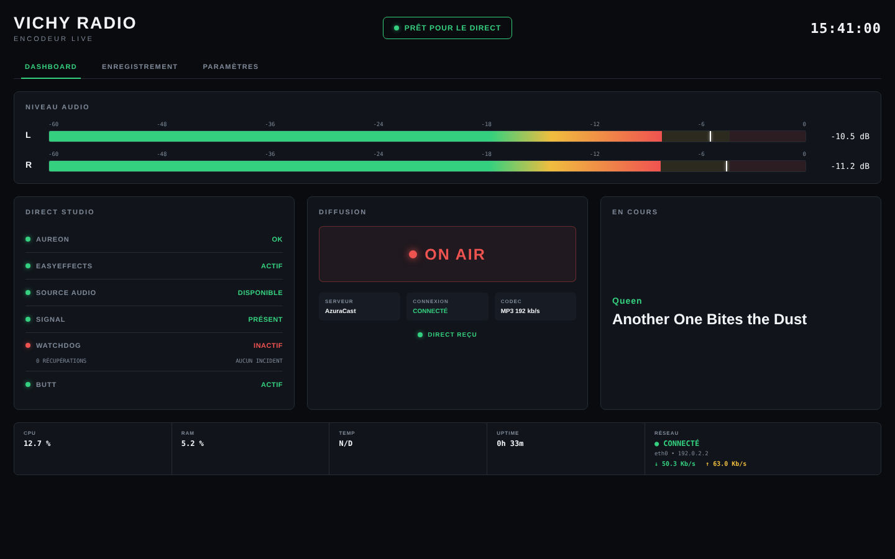
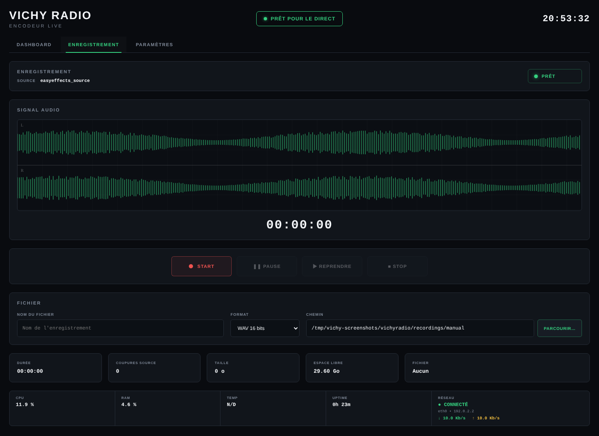
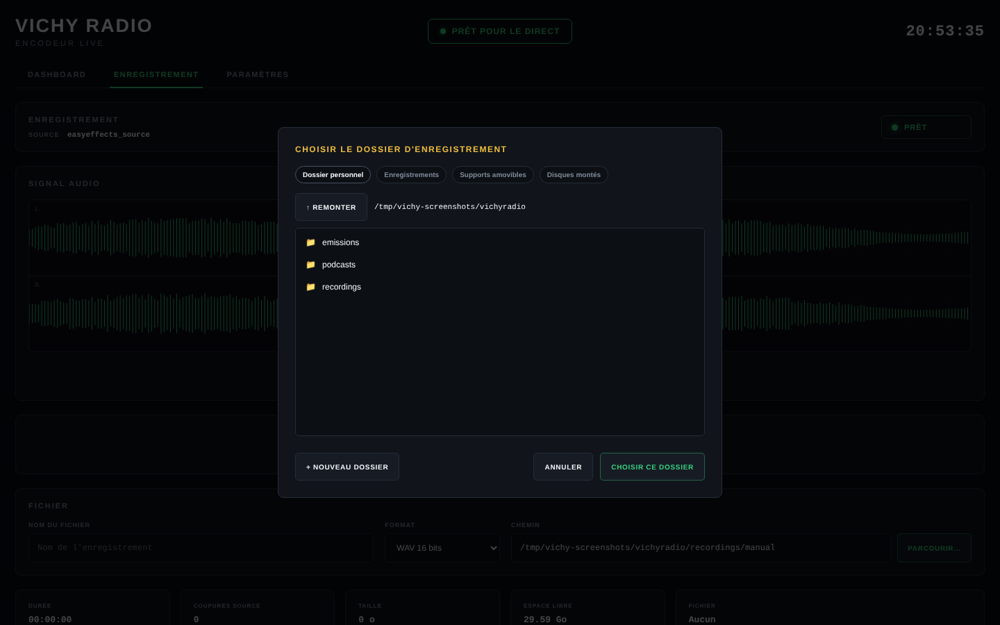

# radio-encoder-recoder

[](https://github.com/dockev03/radio-encoder-recoder/actions/workflows/ci.yml)

Tableau de bord web de l'encodeur live de **Vichy Radio**.

Il tourne sur le PC encodeur (Linux) et s'utilise depuis n'importe quel navigateur du réseau de la régie pour :

- **monitorer le son entrant** : VU-mètre gauche/droite et forme d'onde, en temps réel ;
- **surveiller la diffusion** : état de BUTT, du flux vers AzuraCast et du titre en cours ;
- **enregistrer manuellement** l'antenne, à la manière d'Audacity : démarrage, pause, reprise, arrêt, en WAV, FLAC ou MP3 ;
- **suivre la machine** : CPU, RAM, température, réseau, watchdog audio.

---

## Aperçu

> Captures générées en mode DEV (données simulées) avec `scripts/screenshots.py`.

### Dashboard



### Enregistrement



### Explorateur de dossiers



---

## Sommaire

- [Aperçu](#aperçu)
- [Architecture](#architecture)
- [Prérequis](#prérequis)
- [Installation](#installation)
- [Lancement](#lancement)
- [Configuration](#configuration)
- [API](#api)
- [Sécurité](#sécurité)
- [Développement](#développement)
- [Contribution](#contribution)

---

## Architecture

```
Table de mixage
      │
      ▼
Aureon 5.1 MkII (USB)
      │
      ▼
PipeWire ──► EasyEffects ──► easyeffects_source
                                   │
             ┌─────────────────────┼─────────────────────┐
             ▼                     ▼                     ▼
           BUTT             pw-cat (VU-mètre)      FFmpeg (enregistrement)
             │                     │                     │
             ▼                     └──────────┬──────────┘
        AzuraCast                             ▼
                                   Dashboard Flask (:8080)
                                              │
                                              ▼
                                  Navigateurs de la régie
```

| Élément | Rôle |
|---|---|
| `app.py` | Application Flask : page du dashboard et API JSON |
| `config.py` | Lecture de la configuration (variables d'environnement) |
| `services/audio.py` | Présence de l'Aureon (`lsusb`), d'EasyEffects (`pgrep`), niveaux audio |
| `services/audio_meter.py` | Capture `pw-cat` en tâche de fond : niveaux dB et forme d'onde |
| `services/recording.py` | Moteur d'enregistrement FFmpeg (segments + assemblage final) |
| `services/stream.py` | État de BUTT et du flux AzuraCast |
| `services/system.py` | CPU, RAM, température, uptime, réseau (`psutil`) |
| `services/watchdog.py` | Lecture de l'état du watchdog audio (`/tmp/vichy-audio-watchdog.json`) |
| `services/filesystem.py` | Explorateur de dossiers côté serveur, limité aux racines autorisées |
| `templates/`, `static/` | Interface web (HTML, CSS, JavaScript sans framework) |

### Enregistrement

- **Source** : `easyeffects_source`, 48 kHz, stéréo.
- **Pause / reprise** : chaque reprise ouvre un nouveau segment WAV dans un dossier temporaire. À l'arrêt, les segments sont assemblés puis encodés dans le format choisi.
- **Formats** :

| Format | Encodage |
|---|---|
| `wav` | PCM 24 bits |
| `flac` | FLAC, compression 5 |
| `mp3` | LAME 320 kb/s |

- **Dossier par défaut** : `~/recordings/manual`.
- **Nom par défaut** : `enregistrement_JJMMAAAA-HHMMSS`.
- **Fichier déjà existant** : au choix, erreur, copie numérotée ou écrasement.

---

## Prérequis

### Machine encodeur (mode PROD)

- Linux avec **PipeWire** (`pw-cat`, `pactl` via `pipewire-pulse`)
- **EasyEffects**, exposant la source `easyeffects_source`
- **FFmpeg** avec l'entrée `pulse` et l'encodeur `libmp3lame`
- **BUTT**, pour la diffusion vers AzuraCast
- `usbutils` (`lsusb`) et `procps` (`pgrep`)
- Carte son **TerraTec Aureon 5.1 MkII** (USB `0ccd:0028`)
- **Python 3.13**

Exemple sous Debian / Ubuntu :

```bash
sudo apt install python3 python3-venv ffmpeg pipewire-pulse easyeffects usbutils procps
```

### Poste de développement (mode DEV)

Seul **Python 3.13** est nécessaire. En mode DEV, l'audio (niveaux et forme d'onde), le flux et le titre en cours sont simulés.

---

## Installation

```bash
git clone https://github.com/dockev03/radio-encoder-recoder.git
cd radio-encoder-recoder/VichyRadio.EncoderDashboard

python3 -m venv .venv
source .venv/bin/activate          # Windows : .venv\Scripts\activate

pip install -r requirements.txt
```

---

## Lancement

### Développement

```bash
python app.py
```

Le dashboard est alors disponible sur <http://localhost:8080>.

Pour activer le debugger Flask et le rechargement automatique :

```bash
VICHY_DASHBOARD_DEBUG=1 python app.py
# Windows (PowerShell) : $env:VICHY_DASHBOARD_DEBUG = "1"; python app.py
```

> Avec le debugger actif, l'application n'écoute **que sur `127.0.0.1`**, quelle que soit la valeur de `VICHY_DASHBOARD_HOST`.

### Production (encodeur)

```bash
VICHY_DASHBOARD_MODE=PROD python app.py
```

Le dashboard est accessible depuis la régie sur `http://<ip-encodeur>:8080`.

Exemple de service **systemd utilisateur**, à placer dans `~/.config/systemd/user/vichy-dashboard.service`. Il doit tourner dans la session de l'utilisateur pour accéder à PipeWire.

```ini
[Unit]
Description=Vichy Radio - Dashboard encodeur
After=pipewire.service

[Service]
WorkingDirectory=%h/radio-encoder-recoder/VichyRadio.EncoderDashboard
Environment=VICHY_DASHBOARD_MODE=PROD
ExecStart=%h/radio-encoder-recoder/VichyRadio.EncoderDashboard/.venv/bin/python app.py
Restart=on-failure

[Install]
WantedBy=default.target
```

```bash
systemctl --user daemon-reload
systemctl --user enable --now vichy-dashboard

# Démarrage au boot, sans ouverture de session :
sudo loginctl enable-linger $USER
```

---

## Configuration

Toute la configuration passe par des variables d'environnement.

| Variable | Défaut | Description |
|---|---|---|
| `VICHY_DASHBOARD_MODE` | `DEV` | `DEV` (données simulées) ou `PROD` (matériel réel) |
| `VICHY_DASHBOARD_HOST` | `0.0.0.0` | Adresse d'écoute |
| `VICHY_DASHBOARD_PORT` | `8080` | Port d'écoute |
| `VICHY_DASHBOARD_DEBUG` | `0` | `1` active le debugger Flask (DEV uniquement, écoute forcée sur `127.0.0.1`) |
| `VICHY_DASHBOARD_ALLOWED_ROOTS` | `~:/media:/mnt` | Dossiers autorisés pour l'explorateur et les enregistrements, séparés par `:` |

---

## API

Toutes les réponses sont en JSON. Les requêtes `POST` doivent être envoyées avec `Content-Type: application/json`, sinon elles sont refusées (`415`).

| Méthode | Route | Description |
|---|---|---|
| `GET` | `/` | Page du dashboard |
| `GET` | `/api/status` | État global : audio, réseau, flux, système, watchdog, enregistrement, titre en cours |
| `GET` | `/api/audio` | Niveaux gauche/droite (dB) et présence du signal |
| `GET` | `/api/audio/waveform` | Points de la forme d'onde |
| `GET` | `/api/recording/status` | État de l'enregistrement |
| `POST` | `/api/recording/start` | Démarre un enregistrement |
| `POST` | `/api/recording/pause` | Met en pause |
| `POST` | `/api/recording/resume` | Reprend |
| `POST` | `/api/recording/stop` | Arrête et finalise le fichier |
| `GET` | `/api/filesystem/directories?path=…` | Liste les sous-dossiers |
| `POST` | `/api/filesystem/directories` | Crée un dossier (`parent`, `name`) |

Exemple de démarrage d'enregistrement :

```bash
curl -X POST http://localhost:8080/api/recording/start \
  -H "Content-Type: application/json" \
  -d '{"directory": "~/recordings/manual", "filename": "emission", "format": "flac", "collision": "copy"}'
```

| Champ | Valeurs | Défaut |
|---|---|---|
| `directory` | Dossier sous une racine autorisée | `~/recordings/manual` |
| `filename` | Nom sans chemin, l'extension est ajoutée automatiquement | horodaté |
| `format` | `wav`, `flac`, `mp3` | `wav` |
| `collision` | `error`, `copy`, `overwrite` | `error` |

| Code | Signification |
|---|---|
| `400` | Format, mode de collision ou nom de dossier invalide |
| `403` | Dossier hors des racines autorisées, ou accès refusé |
| `409` | Fichier ou dossier existant, enregistrement déjà en cours, ou aucun enregistrement |
| `415` | Requête `POST` sans JSON |

---

## Sécurité

Le dashboard est conçu pour un **réseau local de confiance** et n'a pas d'authentification.

- **Debugger Flask** : désactivé par défaut, jamais actif en PROD. Quand il est activé, l'écoute est forcée sur `127.0.0.1`.
- **CSRF** : les `POST` doivent être envoyés en JSON. Une page tierce ouverte dans le navigateur d'un poste de la régie ne peut donc pas piloter l'enregistrement.
- **Système de fichiers** : navigation, création de dossiers et enregistrements sont limités à `VICHY_DASHBOARD_ALLOWED_ROOTS`. Les dossiers cachés et les liens symboliques sortants sont refusés.
- **CI** : chaque PR passe par un scan [Trivy](https://trivy.dev/) (vulnérabilités, secrets, mauvaise configuration).

Recommandations côté machine :

- Ouvrir le port `8080` **uniquement au sous-réseau de la régie**, par exemple :
  ```bash
  sudo ufw allow from 192.168.1.0/24 to any port 8080 proto tcp
  ```
- Ne jamais exposer le dashboard sur Internet sans ajouter une authentification, par exemple derrière un reverse proxy ou un VPN.

---

## Développement

```bash
cd VichyRadio.EncoderDashboard
pip install -r requirements-dev.txt

ruff check .        # lint
pytest              # tests
```

### Captures d'écran

Les captures du README sont générées automatiquement, en mode DEV et avec un dossier personnel fictif :

```bash
playwright install chromium         # une seule fois
python scripts/screenshots.py       # écrit docs/screenshots/*.png
```

Toute PR qui ajoute ou modifie une fonctionnalité ou l'interface doit régénérer ces captures et mettre à jour le README.

La CI GitHub Actions (`.github/workflows/ci.yml`) s'exécute sur chaque PR et chaque push sur `main` :

| Job | Contenu |
|---|---|
| `lint-test` | `ruff check` + `pytest` (Python 3.13, mode DEV) |
| `trivy` | Scan du dépôt, échec sur vulnérabilité HIGH/CRITICAL corrigeable |
| `screenshots` | Sur chaque PR : génère les captures et les joint au run (artefact `captures-pr-N`) |

---

## Contribution

Les règles complètes sont dans [`AGENTS.md`](AGENTS.md). En résumé :

- **Pas de commit direct** sur `main`, `master` ou `staging`.
- **Une branche par évolution** : `feature/etape-N-sujet`, `feature/sujet`, `fix/sujet` ou `docs/sujet`.
- **Commits** au format [Conventional Commits](https://www.conventionalcommits.org/fr/), par exemple `feat(player): …`.
- **CI au vert** avant fusion, et toute nouvelle logique arrive avec ses tests.
- **README et captures d'écran à jour** dès qu'une fonctionnalité ou l'interface change.
- **Aucun secret** dans le dépôt : variables d'environnement ou GitHub Actions Secrets.
- **Fusion des PR** par le mainteneur uniquement.
